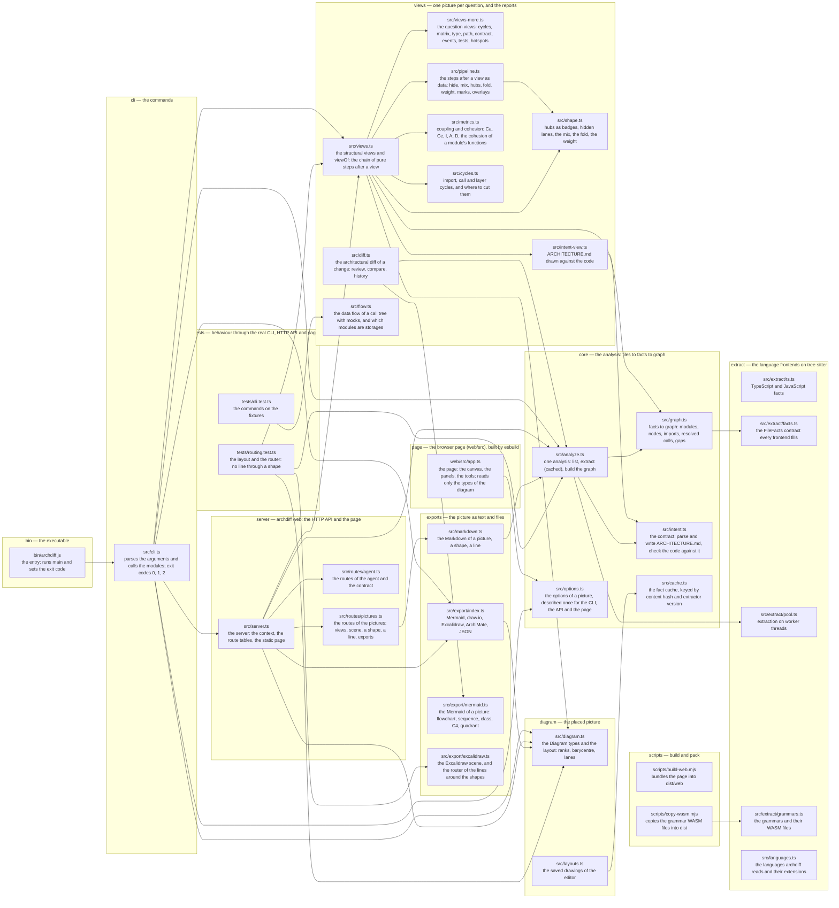

# Architecture

archdiff's own contract, kept by archdiff: `archdiff check` fails when an import crosses the layers against the arrows below, `archdiff diagram intent` draws this file against the code. A subgraph is a layer, a node is a module (its path, then what it does), an arrow is an import. The modules named here are the ones that stand for their layer; `archdiff.json` places every other file in its layer by path.

The direction of the arrows is the direction of the pipeline: the entry points (bin, cli, server, page) read the products (views, exports), which read the placed picture (diagram), which reads the analysis (core), which reads the language frontends (extract). Nothing below imports anything above it except types.

The page (`web/src`) imports the table of picture options from `src/options.ts` (free of Node, bundled into the page) and only types from `src/diagram.ts` and `src/scene.ts`, which erase at build time. Tests import whatever they test. `src/routes/context.ts` imports the `ServeOptions` type back from `server.ts`: a type, inside one layer.
