# Architecture

archdiff's own contract, kept by archdiff: `archdiff check` fails when an import crosses the layers against the arrows below, `archdiff diagram intent` draws this file against the code. A subgraph is a layer, a node is a module (its path, then what it does), an arrow is an import. The modules named here are the ones that stand for their layer; `archdiff.json` places every other file in its layer by path.

The direction of the arrows is the direction of the pipeline: the entry points (bin, cli, server, page) go through the edge (git, the files and the processes a command reads or runs: the picture of a view with its saved drawing, a review's revisions, a run, the specs, a scaffold) to the products (views, exports), which read the placed picture (diagram), which reads the analysis (core), which reads the language frontends (extract). The views are pure: what they need from git or a file the edge reads for them. Nothing below imports anything above it except types.

```mermaid
flowchart LR
  subgraph n_bin["bin — the executable"]
    n_bin_archdiff_js["bin/archdiff.js<br>the entry: runs main and sets the exit code"]
  end
  subgraph n_cli["cli — the commands"]
    n_src_cli_ts["src/cli.ts<br>parses the arguments and calls the modules; exit codes 0, 1, 2"]
  end
  subgraph n_server["server — archdiff web: the HTTP API and the page"]
    n_src_server_ts["src/server.ts<br>the server: the context, the route tables, the static page"]
    n_src_routes_pictures_ts["src/routes/pictures.ts<br>the routes of the pictures: views, scene, a shape, a line, exports"]
    n_src_routes_agent_ts["src/routes/agent.ts<br>the routes of the agent and the contract"]
  end
  subgraph n_page["page — the browser page (web/src), built by esbuild"]
    n_web_src_app_ts["web/src/app.ts<br>the page: the current picture, drawn again when the link or the code changes; the panels, the picking, the toolbar and the keys in modules beside it; reads only the types of the diagram"]
    n_web_src_project_map_ts["web/src/project-map.ts<br>the project map: the repository as dots laid out by forces"]
  end
  subgraph n_edge["edge — what a command reads from git and the files, and the processes it runs"]
    n_src_picture_ts["src/picture.ts<br>the picture of a view: what it reads at the edge, drawn, placed at the saved drawing, stamped, as Markdown"]
    n_src_review_ts["src/review.ts<br>a change read from git: a review, several heads, every commit of a range"]
    n_src_run_ts["src/run.ts<br>a real run of an entry with the storages mocked, traced function by function"]
    n_src_spec_ts["src/spec.ts<br>the specs and features of the repository, the agent's task for them, the OpenSpec CLI"]
    n_src_scaffold_ts["src/scaffold.ts<br>a project from scratch with its intent and first commit"]
    n_src_gherkin_ts["src/gherkin.ts<br>Gherkin features as data, and test skeletons written from them"]
  end
  subgraph n_views["views — one picture per question, and the reports; pure functions of the analysis"]
    n_src_views_ts["src/views.ts<br>the structural views and viewOf: the chain of pure steps after a view"]
    n_src_views_more_ts["src/views-more.ts<br>the question views: cycles, matrix, type, path, contract, events, tests, hotspots"]
    n_src_shape_ts["src/shape.ts<br>hubs as badges, hidden lanes, the mix, the fold, the weight"]
    n_src_diff_ts["src/diff.ts<br>the architectural diff of two graphs: the review's and the comparison's pictures, their Markdown"]
    n_src_intent_view_ts["src/intent-view.ts<br>ARCHITECTURE.md drawn against the code"]
    n_src_flow_ts["src/flow.ts<br>the data flow of a call tree with mocks, and which modules are storages"]
    n_src_pipeline_ts["src/pipeline.ts<br>the steps after a view as data: hide, mix, hubs, fold, weight, marks, overlays"]
    n_src_metrics_ts["src/metrics.ts<br>coupling and cohesion: Ca, Ce, I, A, D, the cohesion of a module's functions"]
    n_src_cycles_ts["src/cycles.ts<br>import, call and layer cycles, and where to cut them"]
    n_src_machines_ts["src/machines.ts<br>state machines: declared by a library, or written with literal states"]
    n_src_logic_ts["src/logic.ts<br>a function's body as a flowchart with its paths as rules, and the list of branching functions"]
    n_src_project_map_ts["src/project-map.ts<br>the whole repository as dots and lines for the page's project map"]
  end
  subgraph n_exports["exports — the picture as text and files"]
    n_src_export_index_ts["src/export/index.ts<br>Mermaid, draw.io, Excalidraw, ArchiMate, JSON"]
    n_src_markdown_ts["src/markdown.ts<br>the Markdown of a picture, a shape, a line"]
    n_src_postman_ts["src/postman.ts<br>a Postman collection of the operations the code calls, with their contracts as used"]
    n_src_export_mermaid_ts["src/export/mermaid.ts<br>the Mermaid of a picture: flowchart, sequence, class, C4, quadrant"]
    n_src_export_excalidraw_ts["src/export/excalidraw.ts<br>the Excalidraw scene, and the router of the lines around the shapes"]
  end
  subgraph n_diagram["diagram — the placed picture"]
    n_src_diagram_ts["src/diagram.ts<br>the Diagram types and the layout: ranks, barycentre, lanes"]
    n_src_drawings_ts["src/drawings.ts<br>the saved drawings of the editor"]
  end
  subgraph n_core["core — the analysis: files to facts to graph"]
    n_src_analyze_ts["src/analyze.ts<br>one analysis: list, extract (cached), build the graph"]
    n_src_graph_ts["src/graph.ts<br>facts to graph: modules, nodes, imports, resolved calls, gaps"]
    n_src_intent_ts["src/intent.ts<br>the contract: parse and write ARCHITECTURE.md, check the code against it"]
    n_src_cache_ts["src/cache.ts<br>the fact cache, keyed by content hash and extractor version"]
    n_src_options_ts["src/options.ts<br>the options of a picture, described once for the CLI, the API and the page"]
    n_src_view_keys_ts["src/view-keys.ts<br>the table of the kinds of view — key, question, where each shows — and the codec of their keys for the CLI, the API and the page"]
    n_src_shape_keys_ts["src/shape-keys.ts<br>what a shape stands for and the view it opens, for the exports and the page"]
    n_src_looks_ts["src/looks.ts<br>the look of every kind of shape and line, for the exports and the page's 3D view"]
    n_src_run_hooks_ts["src/run-hooks.ts<br>the child process of a run: module hooks that trace and mock"]
    n_src_checks_ts["src/checks.ts<br>the contract check and the commands run after an agent"]
    n_src_apis_ts["src/apis.ts<br>the operations of an external API a call names (SCAPI), the OCAPI hooks, the ids and labels"]
    n_src_contracts_ts["src/contracts.ts<br>the contract of an operation as the code uses it: what it sends, what it reads of the result"]
    n_src_scapi_table_ts["src/scapi-table.ts<br>the SCAPI families and operations of the storefront-next runtime, generated"]
    n_src_scapi_runtime_ts["src/scapi-runtime.ts<br>the SCAPI table a repository works against: its runtime's declarations read in node_modules, else the shipped table"]
    n_src_collections_ts["src/collections.ts<br>the Postman collections of the repository as requests, the routes of the operations the code calls, and the match between them"]
  end
  subgraph n_extract["extract — the language frontends on tree-sitter"]
    n_src_extract_ts_ts["src/extract/ts.ts<br>TypeScript and JavaScript facts"]
    n_src_extract_any_ts["src/extract/any.ts<br>the frontend of a file, by its language"]
    n_src_extract_facts_ts["src/extract/facts.ts<br>the FileFacts contract every frontend fills"]
    n_src_extract_control_ts["src/extract/control.ts<br>control flow as facts: guards, literal states, declared machines, the count of branches"]
    n_src_extract_logic_ts["src/extract/logic.ts<br>one function's body read into a control-flow graph, on demand"]
    n_src_extract_bodies_ts["src/extract/bodies.ts<br>where every function's body starts and ends, for the run's trace"]
    n_src_extract_pool_ts["src/extract/pool.ts<br>extraction on worker threads"]
    n_src_extract_grammars_ts["src/extract/grammars.ts<br>the grammars and their WASM files"]
    n_src_languages_ts["src/languages.ts<br>the languages archdiff reads and their extensions"]
  end
  subgraph n_tests["tests — behaviour through the real CLI, HTTP API and page"]
    n_tests_cli_test_ts["tests/cli.test.ts<br>the commands on the fixtures"]
    n_tests_routing_test_ts["tests/routing.test.ts<br>the layout and the router: no line through a shape"]
    n_tests_extract_test_ts["tests/extract.test.ts<br>the language frontends on snippets"]
  end
  subgraph n_scripts["scripts — build and pack"]
    n_scripts_build_web_mjs["scripts/build-web.mjs<br>bundles the page into dist/web"]
    n_scripts_copy_wasm_mjs["scripts/copy-wasm.mjs<br>copies the grammar WASM files into dist"]
    n_scripts_scapi_table_mjs["scripts/scapi-table.mjs<br>regenerates src/scapi-table.ts from a runtime's declarations, with core's reader"]
  end
  n_bin_archdiff_js --> n_src_cli_ts
  n_scripts_scapi_table_mjs --> n_src_scapi_runtime_ts
  n_src_cli_ts --> n_src_server_ts
  n_src_cli_ts --> n_src_views_ts
  n_src_cli_ts --> n_src_export_index_ts
  n_src_cli_ts --> n_src_drawings_ts
  n_src_cli_ts --> n_src_analyze_ts
  n_src_server_ts --> n_src_routes_pictures_ts
  n_src_server_ts --> n_src_routes_agent_ts
  n_src_server_ts --> n_src_picture_ts
  n_src_server_ts --> n_src_analyze_ts
  n_src_routes_pictures_ts --> n_src_views_ts
  n_src_routes_pictures_ts --> n_src_export_index_ts
  n_src_routes_pictures_ts --> n_src_drawings_ts
  n_src_routes_pictures_ts --> n_src_markdown_ts
  n_web_src_app_ts --> n_src_options_ts
  n_web_src_app_ts --> n_src_view_keys_ts
  n_web_src_app_ts --> n_src_shape_keys_ts
  n_src_export_excalidraw_ts --> n_src_shape_keys_ts
  n_src_cli_ts --> n_src_options_ts
  n_src_views_ts --> n_src_views_more_ts
  n_src_views_ts --> n_src_pipeline_ts
  n_src_views_ts --> n_src_metrics_ts
  n_src_views_ts --> n_src_cycles_ts
  n_src_views_ts --> n_src_machines_ts
  n_src_cli_ts --> n_src_picture_ts
  n_src_picture_ts --> n_src_views_ts
  n_src_picture_ts --> n_src_markdown_ts
  n_src_picture_ts --> n_src_drawings_ts
  n_src_picture_ts --> n_src_analyze_ts
  n_src_picture_ts --> n_src_extract_logic_ts
  n_src_review_ts --> n_src_diff_ts
  n_src_cli_ts --> n_src_run_ts
  n_src_run_ts --> n_src_flow_ts
  n_src_run_ts --> n_src_extract_bodies_ts
  n_src_views_ts --> n_src_logic_ts
  n_src_routes_pictures_ts --> n_src_project_map_ts
  n_src_extract_logic_ts --> n_src_extract_control_ts
  n_src_server_ts --> n_src_checks_ts
  n_src_extract_ts_ts --> n_src_extract_control_ts
  n_src_pipeline_ts --> n_src_shape_ts
  n_src_views_ts --> n_src_shape_ts
  n_src_views_ts --> n_src_intent_view_ts
  n_src_views_ts --> n_src_diagram_ts
  n_src_views_ts --> n_src_graph_ts
  n_src_diff_ts --> n_src_export_mermaid_ts
  n_src_diff_ts --> n_src_intent_ts
  n_src_intent_view_ts --> n_src_intent_ts
  n_src_export_index_ts --> n_src_diagram_ts
  n_src_markdown_ts --> n_src_analyze_ts
  n_src_drawings_ts --> n_src_cache_ts
  n_src_analyze_ts --> n_src_graph_ts
  n_src_analyze_ts --> n_src_intent_ts
  n_src_analyze_ts --> n_src_extract_pool_ts
  n_src_graph_ts --> n_src_extract_facts_ts
  n_tests_cli_test_ts --> n_src_flow_ts
  n_tests_routing_test_ts --> n_src_views_ts
  n_tests_extract_test_ts --> n_src_extract_any_ts
  n_tests_routing_test_ts --> n_src_export_excalidraw_ts
  n_tests_routing_test_ts --> n_src_diagram_ts
  n_tests_routing_test_ts --> n_src_analyze_ts
  n_scripts_copy_wasm_mjs --> n_src_extract_grammars_ts
```

The page (`web/src`) imports the Node-free vocabularies of the core, bundled into it — the table of picture options (`src/options.ts`), the kinds of view with their keys (`src/view-keys.ts`) and what a shape stands for and opens (`src/shape-keys.ts`, which the Excalidraw export shares), the looks of the shapes and lines (`src/looks.ts`, which the exports draw by too) — and only types from `src/diagram.ts` and `src/scene.ts`, which erase at build time. Tests import whatever they test. `src/routes/context.ts` imports the `ServeOptions` type back from `server.ts`: a type, inside one layer.
